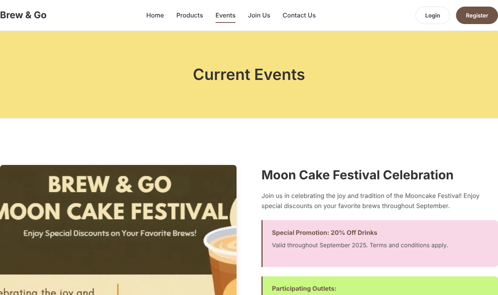
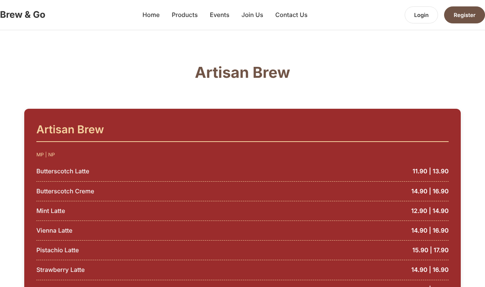
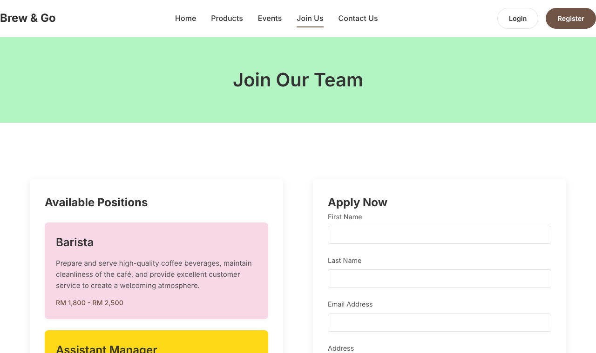

# ☕ Brew & Go: Coffee Shop Website


> *"Every Cup, a New Journey."* A multi-page, responsive website for **Brew & Go**, a fictional Malaysian coffee chain. It has menus, events, membership, careers and contact pages, all built by hand with HTML, CSS and a little JavaScript. No frameworks.



## ✨ Features

- **18 linked pages** with a shared, consistent layout.
- **Sticky frosted-glass navbar** with dropdown menus for Products and Events.
- **Responsive design:** breakpoints at 1024 px and 768 px. On small screens the navigation becomes a JavaScript **hamburger menu**.
- **Product menus** in four categories, with two price tiers (MP / NP) for each drink.
- **Events section** with current, coming-soon and past events, promotional posters and a photo gallery.
- **Forms** for login, registration, job applications and enquiries, using semantic input types (`email`, `tel`, `password`, `file`) and built-in HTML5 validation (`pattern`, `maxlength`, `required`). For example, names must be letters only and postcodes must be 5 digits.
- **Design system:** colours set as CSS custom properties (`--primary-brown`, `--footer-bg`, ...) so the theme stays consistent and is easy to change.

<table>
  <tr>
    <td></td>
    <td></td>
  </tr>
  <tr>
    <td align="center"><sub>Menu page with two price tiers</sub></td>
    <td align="center"><sub>Careers page with application form</sub></td>
  </tr>
</table>

## 🗺️ Site map

| Section | Pages |
|---|---|
| **Home** | `index.html` |
| **Products** | `basic-brew.html` · `artisan-brew.html` · `non-coffee.html` · `hot-beverages.html` |
| **Events** | `events-current.html` · `events-coming-soon.html` · `events-past.html` |
| **About** | `our-story.html` · `coffee-culture.html` · `team-members.html` |
| **Membership** | `benefits.html` · `login.html` · `registration.html` |
| **Customer service** | `delivery.html` · `faq.html` · `enquiry.html` · `join-us.html` |

## 🚀 Run it locally

No build step and nothing to install.

```bash
git clone https://github.com/kfahchai-netizen/COS10026-BREW-AND-GO-WEBSITE-DESIGN.git
cd COS10026-BREW-AND-GO-WEBSITE-DESIGN
# then open index.html in your browser
```

> 💡 **Tip:** turn on **GitHub Pages** (Settings → Pages → deploy from `main`) to get a live demo link for your profile.

## 🛠️ Built with

- **HTML5:** semantic structure, accessible forms
- **CSS3:** Flexbox, CSS variables, media queries, `backdrop-filter`, hover transitions
- **Vanilla JavaScript:** mobile navigation toggle

## 📚 Key concepts

Semantic HTML · HTML5 form validation · Responsive layouts · CSS custom properties · Navigation design · Form design · Multi-page site structure

---

<sub>Made by **Kean Fah Chai** · Swinburne University of Technology Sarawak · Brew & Go is a fictional brand created for coursework.</sub>
